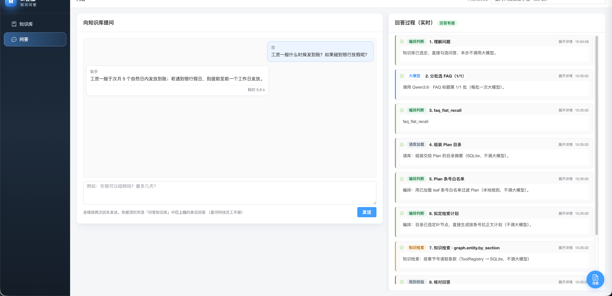

# AmendAQ

**AmendAQ: a support agent that answers from published Q&A you can revise one row at a time — not from retrieved chunks.**

[](LICENSE)
[](pyproject.toml)
[](https://dev.to/zealot2002/series/47234)

You choose a knowledge base. The model only ticks published item IDs from the title list. It must write the answer from those full texts. A rule-based verifier — not another model call — rejects replies that invent obligations or contradict the source. Changing one rule means editing that published row. The next question reads the new text. There is no re-embed step.

This is the runnable slice of a larger idea: RAG should end in knowledge, not in better search. The long-term shape (wiki, state APIs, knowledge requirements) is documented below. What you can run today is [AmendAQ, a better RAG?](https://dev.to/zealot2002/series/47234): pick a library, select IDs, verify by rules.

[中文说明](README.zh-CN.md)

## Why this is not another RAG

| | Chunk + vector + generate | AmendAQ (published FAQ + ID selection + rule verify) |
|---|---|---|
| Source | Raw text chunks | Published FAQ items with full answers |
| Retrieval | Vector similarity / hybrid search | LLM reads the title list and returns only IDs |
| Evidence | A chunk that "looks similar" | The full text of the selected FAQ items |
| Verification | Often none, or "do you think this is correct?" | Deterministic rules: cited source, no invented obligations, no contradiction |
| Failure mode | Hallucinates an answer from nearby chunks | Empty recall → refuses to answer |

## Screenshot

The Vue admin UI includes a process panel on the right side of the chat page that shows every step: skip-understand, title-batch selection, tool calls, compose, and rule verification.



> This is a real capture from an earlier demo. It shows the older Xinghe data, but the visible workflow is the same one this repo runs today: skip understand, batch-select FAQ IDs, load full texts, verify by rules.

## Quick start (Vue / amendaq-api path)

This is the current default runnable path. The older Ollama graph build, `kg_*` APIs, government demo, and Gradio UI still exist in the repo but are not the main entry point.

1. Copy and edit the environment file:

If you cloned before the package rename, point `.env` at `AMENDAQ_*` keys (see `.env.example`) and use `data/amendaq.db`.

```bash
cp .env.example .env
# Edit .env and set a provider:
#   AMENDAQ_LLM=glm    -> fill GLM_API_KEY
#   AMENDAQ_LLM=ollama -> set OLLAMA_BASE_URL to your Ollama host
#   AMENDAQ_LLM=openai -> set OPENAI_API_BASE and OPENAI_MODEL
#   AMENDAQ_LLM=groq   -> set GROQ_API_KEY
```

2. Install Python dependencies and start the dev environment:

```bash
uv sync --extra dev --extra web
scripts/restart-dev.sh
```

The script installs frontend dependencies if needed, starts the FastAPI backend (`amendaq-api`) on port `8765`, and starts the Vite frontend on port `5180`. It prints the local URL, usually `http://127.0.0.1:5180/`.

3. Seed the bundled demo corpus:

```bash
uv run python examples/demo/import_demo.py
```

This creates a fictional library called **Stellar Systems Demo** and imports the 10 Q&A pairs from `examples/demo/stellar_faq.en.txt` as published items.

4. Open the printed URL, go to **Knowledge Base**, click the **Stellar Systems Demo** library, and confirm the items are published.

5. Go to **Chat**, select the demo library, and ask:

- "When is the quarterly bonus paid?"
- "How many remote work days are allowed per week?"
- "Can I bring my pet to the office?" (not in the demo corpus — expect a refusal)

Watch the right-hand process panel: it shows whether the model skipped the understand step, which FAQ IDs it ticked, what full texts were loaded, and whether rule verification passed.

### Advanced: CLI Q&A

If you already have a published library with `document_id` `my_kb`:

```bash
export AMENDAQ_GRAPH_DOCUMENT=my_kb
uv run amendaq "Can I call support on Saturday?"
```

The CLI path is advanced; the Vue UI is the recommended first entry.

## How it actually works

1. **Pick a knowledge base.** When a document is selected in the UI, the agent skips the generic "understand" model call because the user already chose the context.
2. **List published titles.** All `published` FAQ items in that library are loaded. If the count is at or below `AMENDAQ_FAQ_SINGLE_PASS_MAX` (default 200), the whole title list is sent to the model at once. Above that, titles go out in batches of `AMENDAQ_FAQ_BATCH_SIZE` (default 200), and every batch is scanned.
3. **Model returns IDs only.** The model is asked to return only `section_refs` that match the question. IDs that are not in the list are discarded.
4. **Load full texts.** The agent reads the full answer text for each selected ID.
5. **Compose from source.** The model writes the final answer using only those full texts.
6. **Verify with rules.** `Verifier.verify_graph_answer` checks that an answer cites a source, that claims are not invented, and that contradictions like "must ... but not found" are rejected. For bounded quantity problems (e.g. annual leave), a skill computes the numeric bound from the question and the source text before composing the answer.

## Evaluation / reproducibility

A bundled, runnable evaluation is now in `examples/eval/`:

```bash
uv run python examples/eval/run_eval.py        # English FAQ + questions
uv run python examples/eval/run_eval.py --lang zh  # Chinese FAQ + questions
```

It imports the fictional **Stellar Systems Demo** FAQ from `examples/demo/`, runs 12 questions through `AgentLoop`, and scores each answer with the rubric in `examples/eval/RUBRIC.md`. The questions are designed to show the product's strengths (ID selection, rule verification, program-computed numeric answers, refusal when missing). A dry-run mode is available that imports and validates the data without calling an LLM:

```bash
uv run python examples/eval/run_eval.py --dry-run
```

### Chenghai handbook comparison (211×80)

The Chenghai handbook comparison evaluates 211 published Q&A entries across 80 questions (including 30 cross-entry questions), with the same `Qwen3.6` model used by AmendAQ, a fixed traditional RAG pipeline, and LightRAG. All systems read the published Q&A under condition A.

**Condition A scores (by type):**

| Type | Count | AmendAQ | Traditional RAG | LightRAG |
|---|---|---|---|---|
| Single lookup | 9 | 9/9 | 9/9 | 9/9 |
| Obligation | 30 | 29/30 | 28/30 | 25/30 |
| Numeric | 25 | 22/25 | 21/25 | 24/25 |
| Refusal | 8 | 6/8 | 8/8 | 8/8 |
| No fabrication | 8 | 8/8 | 8/8 | 6/8 |
| **Total** | **80** | **74/80** | **74/80** | **72/80** |

**Cross-entry questions (30 requiring 2+ entries):** AmendAQ 29/30, Traditional RAG 27/30, LightRAG 27/30 (condition A/B identical). The original 10 complex questions: AmendAQ 10/10.

**Latency (condition A, median):** Traditional RAG 8.1s (retrieval 4.8s + generation 3.0s), AmendAQ 22.4s, LightRAG 33.9s (indexing 903.0s for LightRAG). AmendAQ is slower and uses more tokens (1,237,956 input tokens for 257 generations across 80 questions).

**Reproduce:**

```bash
uv sync --extra compare
uv run python scripts/run_compare.py --out-dir data/eval/compare200 --report docs/对比测试_澄海手册_200条.md --systems AmendAQ,traditional,lightrag --resume
```

Full write-up: [docs/posts/03-when-to-choose-amendaq.md](docs/posts/03-when-to-choose-amendaq.md). Public fixtures: [handbook source + published Q&A](docs/对比测试_澄海手册_知识库.md) and [questions + rubric answers](docs/对比测试_澄海手册_题目.md).

The original **Xinghe 13-question benchmark** is **still not reproducible from this repo**:

- `scripts/run_xinghe_eval.py` only contains 10 questions, not 13, and now carries a clear header note.
- The source handbook file (`docs/星河科技_中文员工手册_知识库测试.txt`) is missing, so the script cannot re-ingest the evaluated document.
- Some older wiki-tree evaluation reports are stale.
- Some tests hard-code local desktop paths.

## Limits and roadmap

### Current limits

- **Not general vector RAG.** The main path is intentionally a published-FAQ pipeline, not open-domain retrieval.
- **Scale:** Sending published titles in batches of 200 fits tens to low hundreds of items. It is not a million-document search engine.
- **Verification:** Counts and obligations are rule-checked, but the current rules can still be too strict (false rejections) or miss some paraphrased contradictions.
- **Tree descent:** `wiki.toc.*` and `kg_*` code paths still exist but are not the main path used by the Vue UI.

### Roadmap

**Done**
- Published FAQ as the primary source.
- Skip the understand model call when a knowledge base is already selected.
- Rule-based verifier, not LLM self-attestation.
- Bounded numeric answers computed by the program from the source text.

**Next**
- Filter selected IDs by abstract/summary mismatch before composing.
- Hyponym recall (e.g. "laptop" ↔ "device") when the model returns empty.
- On verify failure, delete only the ungrounded sentences instead of rejecting the whole answer.
- Optional vector shortlist to speed up large title lists, but still not vector-as-main-retrieval.

**Later**
- Knowledge world / LLMWiki: entities, relations, events, state, timeline.
- MCP server for the knowledge API.
- Domain state APIs (case/ticket/appointment status) from part 1 of the series.

## Blog series

The code backs the Dev.to series [AmendAQ, a better RAG?](https://dev.to/zealot2002/series/47234).

| # | Title | What it covers |
|---|-------|----------------|
| 1 | [RAG 这六年怎么走过来的、2026 年前沿在做什么、以及它还剩哪些没解决的问题](https://dev.to/zealot2002/ru-guo-tiao-zhi-du-ke-yi-gai-wan-jiu-sheng-xiao-huan-yao-xian-xiang-liang-hua-ma-501b) ([repo](docs/posts/01-why-amendaq.md)) | Six years of RAG, 2026 frontier, vector limits on policy handbooks; AQ / AmendAQ |
| 2 | [我们做了 AmendAQ：可改的问答，发布就是索引](https://dev.to/zealot2002/amendaq-zai-mycs-li-shi-ben-ke-yi-gai-de-wen-da-539) ([repo](docs/posts/02-what-amendaq-is.md)) | Publish gate, ID pick, verify by rules; shortcuts that did not ship |
| 3 | [澄海手册对照：AmendAQ、传统 RAG 与 LightRAG](https://dev.to/zealot2002/tong-ti-dui-zhao-zhi-hou-you-xie-chang-jing-ke-yi-xuan-ze-amendaq-1dhk) ([repo](docs/posts/03-when-to-choose-amendaq.md)) | 103×48 and 211×80 (30 cross-AQ) score tables, per-question matrix, when to pick which path |

Source files: [docs/posts/](docs/posts/). Index: [docs/SERIES.md](docs/SERIES.md).

## License and contributing

MIT © 2026 [zealot2002](https://github.com/zealot2002). See [LICENSE](LICENSE).

Contributions, issues, and PRs are welcome. If you try the quick start and the process panel does not match what you see, please open an issue with the trace file path from `data/traces/`.
