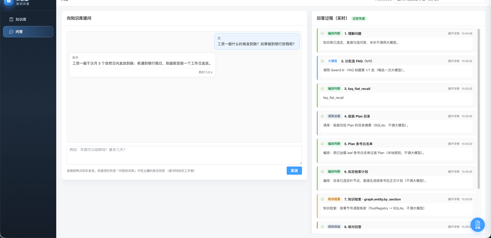

# AmendAQ

**AmendAQ：从可以逐条修订的已发布问答作答，不靠检索回来的文本片段。**

[](LICENSE)
[](pyproject.toml)
[](https://dev.to/zealot2002/series/47234)

你先选一个知识库。模型只从标题列表里勾选已发布条目的编号，必须根据这些条目的完整原文撰写答复。规则校验器——而不是又一次模型调用——会拒绝编造义务或与原文矛盾的答复。改一条制度就是打开那一条再发布，下一问读到的是新正文，不用重新嵌入。

这是更大想法的一个可运行切片：RAG 的终点应该是知识，而不是更好的搜索。长期形态（Wiki、状态 API、知识缺口）见下文。今天能跑通的路径是 Dev.to 系列 [AmendAQ, a better RAG?](https://dev.to/zealot2002/series/47234)：选库、勾编号、规则核对。

[English README](README.md)

## 这和常见的 RAG 有什么不同

| | Chunk + 向量 + 生成 | AmendAQ（已发布 FAQ + 勾选编号 + 规则核对） |
|---|---|---|
| 来源 | 原始文本片段 | 已发布的 FAQ 条目及其完整答案 |
| 召回 | 向量相似度 / 混合检索 | 模型读标题列表，只返回编号 |
| 证据 | 看起来"相似"的片段 | 被勾选条目的完整原文 |
| 校验 | 常常没有，或"你觉得这对吗？" | 确定性规则：引用来源、禁止编造义务、禁止自相矛盾 |
| 失败模式 | 从近似片段里 hallucinate 答案 | 空召回 → 拒绝作答 |

## 截图

Vue 管理界面的问答页右侧有一个过程面板，会展示每一步：跳过理解、分批勾选标题、工具调用、撰写、规则核对。



> 图中是较早的星河演示数据，但展示的工作流和本仓库当前运行的一致：跳过理解、批量勾选 FAQ 编号、加载完整原文、规则核对。

## 快速开始（Vue / amendaq-api 路径）

这是当前默认的可运行路径。仓库里仍然保留了旧的 Ollama 建图、`kg_*` API、政务 demo、Gradio UI，但它们不是主入口。

若你克隆的是更名前的版本，请让 `.env` 与 `.env.example` 一致（`AMENDAQ_*`），数据库文件用 `data/amendaq.db`。

1. 复制并编辑环境文件：

```bash
cp .env.example .env
# 编辑 .env，选择一家大模型提供商：
#   AMENDAQ_LLM=glm    -> 填写 GLM_API_KEY
#   AMENDAQ_LLM=ollama -> 把 OLLAMA_BASE_URL 指向你的 Ollama 主机
#   AMENDAQ_LLM=openai -> 设置 OPENAI_API_BASE 和 OPENAI_MODEL
#   AMENDAQ_LLM=groq   -> 设置 GROQ_API_KEY
```

2. 安装 Python 依赖并启动开发环境：

```bash
uv sync --extra dev --extra web
scripts/restart-dev.sh
```

脚本会在需要时自动安装前端依赖，然后启动 FastAPI 后端（`amendaq-api`，端口 `8765`）和 Vite 前端（端口 `5180`），并打印本地访问地址，通常是 `http://127.0.0.1:5180/`。

3. 导入仓库自带的演示语料：

```bash
uv run python examples/demo/import_demo.py --lang zh
```

这会创建一个名为 **星际系统演示** 的虚构知识库，并把 `examples/demo/stellar_faq.zh.txt` 里的 10 对问答作为已发布条目导入。

4. 打开打印的地址，进入**知识库**，点开 **星际系统演示**，确认条目已发布。

5. 进入**问答**页，选择该演示库，输入示例问题：

- "季度奖金什么时候发放？"
- "每周最多可远程办公几天？"
- "可以带宠物来办公室吗？"（不在演示语料中，应拒答）

右侧过程面板会显示：理解步骤是否被跳过、模型勾了哪些 FAQ 编号、加载了哪些完整原文、规则核对是否通过。

### 进阶：CLI 问答

如果你已经有了一个 `document_id` 为 `my_kb` 的已发布知识库：

```bash
export AMENDAQ_GRAPH_DOCUMENT=my_kb
uv run amendaq "周六可以打电话找客服吗？"
```

CLI 路径偏进阶；Vue 界面是推荐的首选入口。

## 实际工作原理

1. **选人库。** 当界面里已经选定一个知识库后，Agent 会跳过通用的"理解问题"模型调用，因为上下文已由用户指定。
2. **列出已发布标题。** 加载该库所有 `published` 状态的 FAQ 条目。若数量不超过 `AMENDAQ_FAQ_SINGLE_PASS_MAX`（默认 200），一次性把所有标题发给模型。超过之后按 `AMENDAQ_FAQ_BATCH_SIZE`（默认 200）分批，每一批都走完。
3. **模型只返回编号。** 模型被要求只返回匹配问题的 `section_refs`；不在列表里的编号会被程序丢弃。
4. **加载完整原文。** Agent 按编号读取每条 FAQ 的完整答案。
5. **依据原文撰写。** 模型只能用这些完整原文来写最终答复。
6. **规则核对。** `Verifier.verify_graph_answer` 检查答复是否引用了来源、是否编造义务、是否出现"必须……但未找到"这类矛盾。对有上限的数量题（例如年假），会由技能在撰写前根据问题和原文算出数值边界。

## 评测 / 可复现性

现在仓库里有一套可运行的评测，放在 `examples/eval/`：

```bash
uv run python examples/eval/run_eval.py --lang zh
```

它会导入 `examples/demo/stellar_faq.zh.txt` 里的虚构 **星际系统演示** FAQ，用 12 道题跑一遍 `AgentLoop`，再按 `examples/eval/RUBRIC.md` 里的评分标准打分。这些问题覆盖了产品的强项：编号选择、规则核对、程序计算数量、缺失时拒答。也支持不调用大模型的干跑模式：

```bash
uv run python examples/eval/run_eval.py --lang zh --dry-run
```

### 澄海手册对照（211×80）

澄海手册对照在 211 条已发布问答上测试 80 题（含 30 道跨条题），三家统一使用 `Qwen3.6` 生成模型。条件 A 下，所有系统都读取已发布问答。

**条件 A 分项得分：**

| 类型 | 题数 | AmendAQ | 传统 RAG | LightRAG |
|---|---|---|---|---|
| 单点查找 | 9 | 9/9 | 9/9 | 9/9 |
| 义务对错 | 30 | 29/30 | 28/30 | 25/30 |
| 数字 | 25 | 22/25 | 21/25 | 24/25 |
| 拒答 | 8 | 6/8 | 8/8 | 8/8 |
| 不编造 | 8 | 8/8 | 8/8 | 6/8 |
| **合计** | **80** | **74/80** | **74/80** | **72/80** |

**30 道跨条题（须同时命中两条以上 AQ）：** AmendAQ 29/30，传统 RAG 27/30，LightRAG 27/30（条件 A/B 相同）。原 10 道复杂题：AmendAQ 仍为 **10/10**。新增 20 道跨条题：AmendAQ 19/20。

**延迟（条件 A 中位数）：** 传统 RAG 8.1s（检索 4.8s + 生成 3.0s），AmendAQ 22.4s，LightRAG 33.9s（LightRAG 索引 903.0s）。AmendAQ 更慢且 token 使用更高（80 题共 257 次生成，输入 1,237,956 token）。

**复现：**

```bash
uv sync --extra compare
uv run python scripts/run_compare.py --out-dir data/eval/compare200 --report docs/对比测试_澄海手册_200条.md --systems amendaq,traditional,lightrag --resume
```

`uv sync --extra compare` 即可运行双系统对比（`--systems AmendAQ,traditional`）。若要加入 LightRAG 列，可安装 `lightrag` 附加项（`uv sync --extra compare --extra lightrag`）或设置 `AMENDAQ_LIGHTRAG_ROOT=/path/to/LightRAG`。

完整说明：[docs/posts/03-when-to-choose-amendaq.md](docs/posts/03-when-to-choose-amendaq.md)。公开语料：[测试知识库原文](docs/对比测试_澄海手册_知识库.md)、[80 题题干](docs/对比测试_澄海手册_题目.md)、[跨条 20 道](docs/跨条题-20.md)。

原始 **星河 13 题评测在当前仓库仍然无法复现**：

- `scripts/run_xinghe_eval.py` 里只有 10 道题，不是 13 道，且已在文件头加了明确说明。
- 评测用的源手册文件 `docs/星河科技_中文员工手册_知识库测试.txt` 缺失，脚本无法重新入库。
- 部分较老的 wiki-tree 评测报告已经过时。
- 某些测试硬编码了本地桌面路径。

## 限制与路线图

### 当前限制

- **不是通用向量 RAG。** 主路径刻意保持为已发布 FAQ 流程，不做开放域检索。
- **规模：** 按 200 条一批发送标题，适合几十到两百来条，不是百万文档搜索引擎。
- **核对：** 数量和义务已由规则检查，但当前规则仍可能过严（误伤）或遗漏某些改写后的矛盾。
- **目录钻取：** `wiki.toc.*` 和 `kg_*` 代码路径仍存在，但不是 Vue 界面使用的主路径。

### 路线图

**已完成**
- 以已发布 FAQ 为主要知识来源。
- 知识库已选定时跳过"理解问题"模型调用。
- 规则校验器替代模型自证。
- 有上限的数量由程序根据原文计算。

**下一步**
- 在撰写前按摘要/问题不匹配过滤掉错勾的编号。
- 空召回时利用上下位词召回（如「笔记本」↔「设备」）。
- 核对失败时只删除无依据的句子，而非整段打回。
- 可选的向量短名单以加速大标题列表，但仍然不做向量主检索。

**更长期**
- 知识世界 / LLMWiki：实体、关系、事件、状态、时间轴。
- MCP 服务器暴露 Knowledge API。
- 系列第一篇提到的领域状态 API（办件/工单/预约状态等）。

## 博客系列

本仓库代码支撑 Dev.to 系列 [AmendAQ, a better RAG?](https://dev.to/zealot2002/series/47234)。

| # | 标题 | 内容 |
|---|------|------|
| 1 | [RAG 这六年怎么走过来的、2026 年前沿在做什么、以及它还剩哪些没解决的问题](https://dev.to/zealot2002/ru-guo-tiao-zhi-du-ke-yi-gai-wan-jiu-sheng-xiao-huan-yao-xian-xiang-liang-hua-ma-501b)（[仓库](docs/posts/01-why-amendaq.md)） | 六年 RAG、2026 前沿、制度场景五件事；AQ / AmendAQ |
| 2 | [我们做了 AmendAQ：可改的问答，发布就是索引](https://dev.to/zealot2002/amendaq-zai-mycs-li-shi-ben-ke-yi-gai-de-wen-da-539)（[仓库](docs/posts/02-what-amendaq-is.md)） | 入库、勾编号、核对；试过又拿掉的两条路 |
| 3 | [澄海手册对照：AmendAQ、传统 RAG 与 LightRAG](https://dev.to/zealot2002/tong-ti-dui-zhao-zhi-hou-you-xie-chang-jing-ke-yi-xuan-ze-amendaq-1dhk)（[仓库](docs/posts/03-when-to-choose-amendaq.md)） | 103×48 与 211×80（30 道跨条）汇总表、逐题表、怎么选路线 |

正文在 [docs/posts/](docs/posts/)，索引在 [docs/SERIES.md](docs/SERIES.md)。

## 许可与贡献

MIT © 2026 [zealot2002](https://github.com/zealot2002)。详见 [LICENSE](LICENSE)。

欢迎 issue 和 PR。如果你按快速开始操作后，过程面板展示的内容与文档不符，请附上 `data/traces/` 下的 trace 文件路径开 issue。
