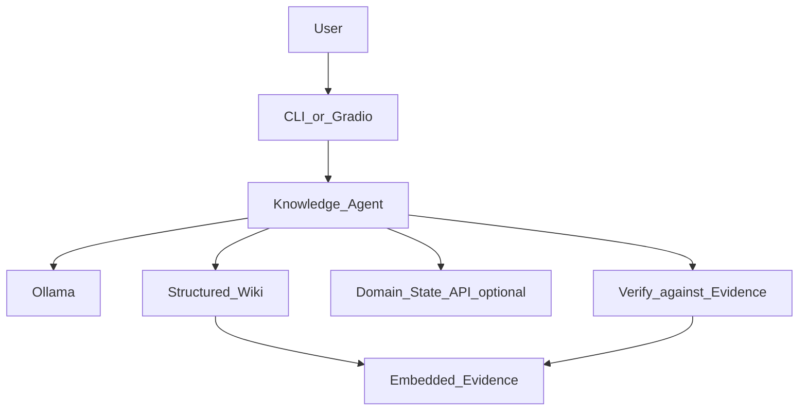

# mycs 智能客服 — 里程碑计划

优先 **把理想架构跑通**（SQLite 知识库 + 缺口驱动 Plan）；博文可后补，不与里程碑强绑定。

**产品定位**：泛化 **智能客服 / 公众咨询 / 办事指引** — 适用于政府、企业、学校等场景。架构不绑定「订单」；动态事实通过可插拔的 **领域状态 API** 接入（办件、工单、学籍、预约等）。

## 架构原则（与 [01-why-amendaq.md](./posts/01-why-amendaq.md) 对齐）

对外系列已收成三篇，从 [01-why-amendaq.md](./posts/01-why-amendaq.md) 读起，索引在 [SERIES.md](./SERIES.md)。下面这张表仍是仓库里的目标分层。

| 层 | 职责 | 本仓库实现 |
|----|------|------------|
| LLM | 推理、规划、生成回复 | Ollama（OpenAI 兼容 API）或可切换云端 |
| Agent | Knowledge Requirement 驱动闭环 | Understand → Plan → Tools → Verify → Answer |
| Wiki | 结构化机构知识 | **SQLite**（`data/mycs.db`）：政策条目 + tag 目录 + **内嵌 evidence** |
| DB/API | **动态事实 / 办事状态**（按领域可选） | FastAPI + SQLite；示例适配器：`Case`（办件/工单/申请） |
| 证据 | 为何相信某条事实 | **Wiki 内 `evidence`（quote + source + 生效时间）**，不用向量 chunk |
| MCP | 对外暴露 Knowledge API | 后期里程碑 |

**明确不做：** 独立「simple chunk / 向量 RAG」里程碑。未入库原文通过 ingest 写入 Wiki 时附带证据引用，Verify 只做确定性比对，不做语义片段检索。

实体召回与节号钉死（`kg_search_entities` 加权打分、search grounding）见 **[本地检索与寻址.md](./本地检索与寻址.md)**。

### 领域适配（同一套 Agent，不同后台）

| 场景 | Wiki 示例 | 动态 API 示例（可选） |
|------|-----------|------------------------|
| 政务 | 事项指南、法规、办理时限 | 办件号 → 当前环节、提交时间 |
| 企业 | 产品说明、SLA、内部流程 | 工单号 → 处理状态 |
| 学校 | 学籍规定、选课规则 | 学号 → 选课/审批状态 |
| 纯咨询 | 仅 FAQ / 政策 | 无 case_id，只走 Wiki |

代码里用 **Reference 场景**（默认：办事咨询 + 可选 `case_id`）做演示；01 文中的电商/iPhone 例子仅作叙事参考，不是域模型约束。



## 技术栈与本地工具

| 类别 | 选型 |
|------|------|
| 语言 | Python 3.11+ |
| 包管理 | uv |
| API | FastAPI |
| 存储 | SQLite |
| LLM | Ollama `http://localhost:11434/v1` |
| 简单 UI | Gradio 或 Streamlit（M2 起） |
| Agent 编排 | **M1–M4 自研 loop**（见下节）；不依赖 LangGraph / LangChain |
| 日志 | `logging`，tag 统一 **joyjoy** |

安装清单见 [README.md](../README.md#本地环境)。

---

## Agent 编排与框架选型

**决策：完全自研主链；M1–M4 不上 LangGraph / LangChain。**

系列博文要讲清 **Knowledge Requirement → Tools → Verify → Answer** 与 01 中的 Knowledge Loop 的对应关系。手写 loop 便于逐步落 **JSON trace**、在 02–05 中写架构踩坑（如 Plan 退化成关键词搜索）。M1–M2 复杂度仅为「线性步骤 + 可选小循环（缺知识则补 Tool，次数上限）」，无需 StateGraph。

| 框架 | 作用 | 本仓库 |
|------|------|--------|
| **LangChain** | 模型消息、Tool 绑定、LCEL 等 | **M1–M4 不引入**；若后续仅为少写 OpenAI 消息格式，可局部评估，非主线 |
| **LangGraph** | 有状态图、多分支、循环、人机中断 | **M1–M4 不引入**；**M6 可选**：HITL 审批、Verify 失败重 Plan、并行 Tool 时再评估 |
| **自研 `AgentLoop`** | 调度 Understand / Plan / Tool / Verify / Answer | **M1 起**为默认实现 |

**原则：** 先稳定 **行为与 trace schema**，再换编排实现；换框架时 **ToolRegistry / Verifier / Knowledge API 不变**，博文可写「图只是调度器，领域逻辑未变」。

### M1 起建议固定的代码边界（便于日后迁 LangGraph）

| 模块 | 职责 |
|------|------|
| `KnowledgeRequirement` | 结构化知识缺口（非 search 关键词列表） |
| `TraceEvent` / `AgentStep` | `plan` \| `tool` \| `verify` \| `answer` 等可序列化事件 |
| `GapResolver` | `KnowledgeRequirement.field` → Knowledge API（如 `find_wiki_policies(topics=…)`） |
| `ToolRegistry` | `find_wiki_policies`、`get_wiki_policy`、`get_case` 等对 SQLite 的薄封装 |
| `Verifier` | 对照 Wiki `evidence` 与 Domain API 返回值；**不以 LLM 自证** |
| `AgentLoop` | 调用 LLM（Mock 或 Ollama）、驱动上列组件 |
| 回答技能插槽 | 按触发词选中外挂技能，把说明交给组答与核对；**不含领域公式** |

### 回答技能：公式在外挂，loop 只留插槽

客服主链保持通用。领域里的数量公式、口径和推理约束不写进 `AgentLoop`，也不做成 Python 计算器。需要专用推理时，外挂一份 `SKILL.md`。换手册、换行业只加技能，不改主链。

插槽只做三件事：

1. 用**问题文本**和**已检索条款文本**匹配技能 frontmatter 里的触发词。
2. 命中后，把技能说明注入组答。说明是推理约束，不是新的事实；数字、时限、金额仍只能来自问题和条款原文。
3. 技能声明 `revise: true` 时，再让模型对照条款原文核对一次草稿。未命中任何技能时，主链与没有技能时相同。

| 项 | 约定 |
|----|------|
| 技能文件 | 每个技能一个目录，内含 `SKILL.md`（frontmatter + 说明正文） |
| 加载顺序 | 内置 `src/mycs/skills/packs/` → 仓库 `skills/` → `MYCS_SKILLS_DIR`；同名以后加载的为准 |
| `question_any` | 问题里命中任一词 |
| `evidence_any` | 已检索条款里命中任一词 |
| 两边都写了 | 必须同时命中才启用 |
| 两边都空 | 不自动启用 |
| 代码 | `src/mycs/skills/loader.py` 加载与匹配；`src/mycs/agent/loop.py` 只调用插槽 |

内置示例 `capped-quantity`：条款同时给出新增数量和上限时，结论为「已有数量 + 新增数量，且不得超过上限」。年假结转只是它的一个命中场景，不是代码分支。

这和「领域状态 API」是两条插槽：API 接入办件、工单等动态事实；技能接入推理约束。`Verifier` 仍只做确定性比对，不用技能说明代替条款原文。

```text
M1  手写 AgentLoop + MockLLM + trace JSON           → 博文 02
M2  同一 loop + Ollama + Gradio                     → 博文 03
M3–M4  Wiki / Case API 接入，loop 仍手写             → 博文 04–05
M5  自研 MCP（与 loop 解耦的服务层）                 → 博文 06
M6  HITL + 评测；LangGraph 可选，非必须              → 博文 07（附录可写迁移对比）
```

**可选后续（非当前里程碑）：** 单独短文或 07 附录 —「从手写 loop 到 LangGraph：保留了哪些状态、Verify 为何仍是独立节点」。**不**替代 M5 MCP 主文，**不**在 M1 默认依赖 LangSmith 等观测 SaaS。

---

## 里程碑

### M0 — 仓库骨架（无独立博文，合入 02 前言）

**交付**

- 目录约定：`src/mycs/`、`tests/`、`data/`、`docs/posts/`
- `pyproject.toml`、`.env.example`、Ollama 连通性检查脚本
- `docs/SERIES.md` 与本文 maintained

**博文** — 无（在 02 开头写「环境与仓库结构」）

---

### M1 — Knowledge Agent 最小闭环（Mock LLM）

**交付**

- **Reference 场景**（二选一或并列文档化）：  
  - 政务风：「办件为什么还在预审？依据哪条时限规定？」  
  - 或纯政策：「某事项能否线上办理？」（无 case_id）  
- `KnowledgeRequirement` 规划结构（非 Search Query 列表）
- Stub Tools 示例：`get_policy`、`get_procedure`、`get_entity`；若有 case_id 则 `get_case` / `get_case_status`
- 规则或脚本 Mock LLM，跑通闭环
- JSON **trace** 落盘（每步 Plan / Tool / Verify）

**博文** — 旧稿已删除。对外系列见 [SERIES.md](./SERIES.md)

**常见坑（预留提纲）** — Plan 写成关键词搜索；Verify 缺失；Tool 返回与 Plan 字段不对齐；把「必须查状态」和「只查政策」混在同一模板

---

### M2 — 真 LLM（Ollama）+ 简单可视化

**交付**

- OpenAI 兼容 client，环境变量切换模型
- Gradio/Streamlit：聊天 + 侧边栏 trace（可选输入 `case_id`）
- Prompt 约束：先输出 Knowledge Requirement 再调 Tool
- `joyjoy` 结构化日志

**博文** — 旧稿已删除。对外系列见 [SERIES.md](./SERIES.md)

**常见坑** — Tool call 不稳定、JSON 格式、小模型跳过 Verify、延迟与超时

---

### M3 — 结构化 Wiki + 内嵌证据

**交付**

- 实体模型：`Policy`、`Procedure`、`Service`、`Concept` 等（按机构可扩展）
- 每条可审核事实带 `evidence: { quote, source_uri, effective_from }`
- Knowledge API：`get_entity`、`get_attribute`、`get_policy`、`get_procedure`、`get_evidence`
- 种子数据：示例办事指南 + 时限/条件政策（可另附 01 文电商例作对照，非硬编码域）

**博文** — 旧稿已删除。对外系列见 [SERIES.md](./SERIES.md)

**常见坑** — 证据与事实字段重复维护；政策版本与 `effective_from`；缺 evidence 时 Verify 策略

**与 chunk 版对比（写在博文中）** — 证据是指针而非相似度检索；无向量库运维；未结构化 PDF 需先 ingest 进 Wiki

---

### M4 — 领域状态 API + 确定性 Verify

**交付**

- **Case 表（泛化）**：`case_id`、事项类型、关联主体、关键日期、当前状态（代表办件/工单/申请，非电商订单）
- Agent 组合 Wiki 条文 +（可选）case 状态生成结论
- Verify：政策类结论必须被 `evidence.quote` 支持；状态类结论必须来自 Domain API 返回值（规则/结构化检查，非 embedding）
- 支持 **无 case 路径**：仅 Wiki + Verify 的政策问答
- 可选：对客回复模板与内部 trace 分离

**博文** — [05-verify-without-chunk-rag.md](./posts/05-verify-without-chunk-rag.md)（待写）

**常见坑** — 用 LLM 自证 Verify；混淆「当前办事状态」与「政策条文」；旧 case 适用政策版本

---

### M5 — MCP 暴露 Knowledge API

**交付**

- MCP Server：`get_entity`、`get_policy`、`get_procedure`、`get_evidence` 等（Domain API 可按权限另暴露）
- 文档：外部 Agent（如 IDE）如何调用
- 与 HTTP API 共用同一套 Wiki 服务层

**博文** — [06-mcp-knowledge-api.md](./posts/06-mcp-knowledge-api.md)（待写）

**常见坑** — MCP 与 REST 双写；权限与只读边界；动态状态是否对 MCP 只读开放

---

### M6 — 知识治理与评测（简版 HITL + 用例集）

**交付**

- 知识变更提案流：AI/脚本 propose → 人工 approve → 写入 Canonical Wiki
- 固定测试集：N 条 **咨询/办事问句** + 期望 Tool 链与 Verify 结果（含纯 Wiki 与 Wiki+Case 两类）
- README 运行说明与 demo 录屏要点

**博文** — [07-hitl-and-eval.md](./posts/07-hitl-and-eval.md)（待写）

**常见坑** — 评测只看最终文案不看 trace；提案无 audit 字段

---

## 已删除的范围（记录决策）

| 原设想 | 决定 |
|--------|------|
| M5 simple chunk + 向量库 | **删除** — 证据由内嵌 Wiki 承担 |
| 博文「RAG 证据层实现」 | **删除** — 改为 04/05 写内嵌证据与无 chunk Verify |
| Hybrid / Semantic Chunk 工程 | **不进入本仓库** — 仅在 01 文中作行业背景 |
| 电商订单为核心域模型 | **删除** — 改为泛化 Case + 可选领域 API |
| M1–M4 使用 LangGraph / LangChain 作为编排核心 | **推迟** — 先自研 loop；M6 可可选评估 LangGraph（HITL/多分支） |

若未来必须对接海量未结构化文档，单独开**新系列或新里程碑**，不与当前客服主路径混用 chunk 检索。

---

## 博文与里程碑对照

| 博文 | 里程碑 | 状态 |
|------|--------|------|
| [01-why-amendaq.md](./posts/01-why-amendaq.md) | 背景 | 对外系列 |
| [02-what-amendaq-is.md](./posts/02-what-amendaq-is.md) | 当前主路径 | 对外系列 |
| [03-when-to-choose-amendaq.md](./posts/03-when-to-choose-amendaq.md) | 对照 | 对外系列 |
| 05-verify-without-chunk-rag | M4 | 待写 |
| 06-mcp-knowledge-api | M5 | 待写 |
| 07-hitl-and-eval | M6 | 待写 |

每篇博文建议结构：**目标 → 实现要点 → 遇到的问题 → 踩坑 → 思考与总结 → 对应 commit/目录指针**。

---

## 当前进度

- [x] 01 背景博文（旧四篇已删除，对外系列见 [SERIES.md](./SERIES.md)）
- [x] 计划定稿（无 chunk；泛化客服域；M1–M4 自研 Agent loop）
- [x] M0 代码骨架
- [x] M1 Mock Agent 闭环 + trace
- [x] M2 Ollama + Gradio UI
- [x] M3 Wiki ingest + handbook QA（初版）
- [ ] M4 领域状态 API 强化 …
