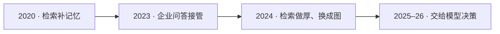

# RAG 这六年怎么走过来的、2026 年前沿在做什么、以及它还剩哪些没解决的问题

> 系列 [AmendAQ, a better RAG?](../SERIES.md)（1/3）  
> 读完这篇：知道「找得到」已经被补得差不多，「用对了」欠了六年还没补。  
> 下一篇：[我们做了 AmendAQ](./02-what-amendaq-is.md)

---

## 一、六年，四代，一条主线

每隔几个月就有人宣布 RAG 死了。我不这么看——死的是其中一种做法，嵌一段、取 Top-K、塞进提示词；检索本身没死，这六年它反而被拆开、重装、交到模型手里。

**2020：检索是为了补模型的记忆。** [RAG 原论文](https://arxiv.org/abs/2005.11401) 把参数化记忆和非参数化记忆拼在一起：模型肚子里没有的，去维基百科取。动机是知识截止和事实性，不是今天这种「公司内部几千份文档怎么答」。

**2023：检索接管企业问答。** 文档切块、嵌入、向量库、取最近几段，朴素 RAG 一夜之间成了内部知识库的标准答案。问题也很快暴露：块切在句子中间、同义词对不上、关键词和语义各抓一边。

**2024：先把检索做厚，再把它换成图。** 混合检索（BM25 + 稠密向量）、RRF 合并、重排模型成了标配，查询改写、查询分解、父子块、多向量切分在这时候变得常见。[GraphRAG](https://arxiv.org/abs/2404.16130) 是这年的分界点：抽实体和关系，做社区摘要，被检索的对象从文本块变成图。

代价也在这年显形。微软自己的口径，完整 GraphRAG 索引约 $50/百万 token，向量嵌入约 $0.5，差一百倍；一个 5 GB 的法律语料被估到三万多美元。于是 [LazyGraphRAG](https://www.microsoft.com/en-us/research/blog/lazygraphrag-setting-a-new-standard-for-quality-and-cost/) 在 2024 年底出来：索引只用轻量词法构图，把 LLM 的活全推到查询时，索引成本压到完整 GraphRAG 的 0.1%，查询成本约为其 4%。到 2026 年 ICLR 的 [LinearRAG](https://github.com/DEEP-PolyU/LinearRAG)，构图干脆不花一个 LLM token，规模线性增长。

**2025 到 2026：检索从一条流水线，变成一个决策。** 标志是模型自己决定要不要搜、搜几次、什么时候停。[Agentic RAG 综述](https://arxiv.org/abs/2501.09136) 把它按 agent 数量、控制结构、自主度拆开；Google 2026 年 6 月放出的跨语料 agentic RAG，在 FramesQA 上把朴素 RAG 的 58.7% 提到 90.1%（语料库里还混着三个干扰数据集）。再往前一步是 Deep Research：Gemini、OpenAI、Claude 都在做多步调查、迭代检索、写带引用的长报告。

同一年，「RAG」这个词开始被别的词替掉。[Thoughtworks 2025 年 11 月的技术雷达](https://www.thoughtworks.com/radar)把主题从 RAG 换成了 agents、MCP 和 **context engineering**；RAGFlow 的年终总结说自己正在从检索模式变成 "context engine"。MCP 在 2024 年底标准化了工具调用面，检索于是变成 agent 手里的一类工具，不再是一条钉死的管线。

四代下来主线没变：**问句和原文长得不像时，怎么把相关文字找回来。** 变的是找法、成本由谁承担、以及谁来按下「搜」这个动作。

---

## 二、向量化丢掉的，不只是精度

把一句话变成向量，是一次有损压缩：原句多长都不管用，最后都是一个固定长度的浮点数组。这些年大家一直在讨论命中率、讨论召回，被这次压缩吃掉的东西反而很少拿出来说。

**数字。** 「结转上限 20 天」和「结转上限 30 天」只差一个字符，向量距离小到可以忽略。改一个数字，在向量空间里几乎不可见——这也是为什么「改一处」最难过验证：你没法用相似度确认旧的那句是不是真的退出了。

**否定和条件。** 「可以收」和「不能收」共享几乎全部上下文词，在训练出来的空间里常常挨得很近。而条款真正的约束是一个「若……则……」，压成定长向量以后，条件从句的权重被整段的平均稀释掉了。

**一题里的第二件事。** 一句话里同时出现「提前通知」和「未休年假折现」，向量记的是这段的整体意思，不是两条并列的义务。取回这一段时，模型看到的是混在一起的两件事。

**换说法和上下位。** 「笔记本丢了」和「设备丢失」词面没有交集，向量有时给一点相似度，有时给不了。稠密向量擅长「话题相近」，不擅长「指同一件事」。

四条合起来是一句：**向量保留的是「这段话在讲什么」，丢掉的是「这句话具体说了什么」。** 找得到，靠前者就够；要做裁决，得靠后者。

**2024 年那次换轨，换的是索引结构。** GraphRAG 把实体和关系显式抽出来，用社区摘要当检索对象，救的是「多跳」和「全局综合」这两类确实问不到的问题。但抽取的输入还是同一段文本、同一次有损处理：一段话被抽成三元组，形容词、条件、例外照样进不了图；抽完通常还要再嵌一次。所以图换掉的是索引的形状，不是压缩这件事本身。

---

## 三、2026 年的前沿在补什么

这四件事值得单独拎出来，因为它们正在重新定义「RAG 做得好」是什么意思。

**1. 把检索接口交给模型。** [A-RAG](https://arxiv.org/abs/2602.03442)（2026 年 2 月）给模型三种接口：关键词精确匹配、语义向量检索、整块原文通读，由模型按预算自己选，循环里还记着已经搜过什么，防止重复取。论文的结论比方法更有意思：瓶颈已经从检索算法转到推理模型本身——同一个架构，换更强的模型、给更多 test-time compute，分数继续涨。也就是说，把预算投在「给 agent 好用的检索接口」，回报高于投在「更好的嵌入」。

**2. 图索引的账还没算完。** 成本那一头已经压下来了，质量那一头不好看：[GraphRAG-Bench](https://arxiv.org/abs/2506.05690) 里，简单事实查找上向量 RAG 加重排 64.7%，LightRAG 63.3%，完整 GraphRAG 38.6%。LinearRAG 那篇还算了一笔账：图方法把证据召回提上去了，上下文相关性（context relevance）却掉到 36.9%–54.6%，不如朴素 RAG 的 62.9%。图把「相关但不该用」的段落也一起搬进了上下文。

**3. 长上下文没杀死 RAG，但改了设计点。** 2026 年的窗口是 1M 到 2M。实际能用的远小于标称：1M 里埋 8 根针，GPT-5.5 找到 74%，Claude Opus 4.7 56%，DeepSeek V4 41%。Chroma 2025 年的 [context rot 报告](https://research.trychroma.com/context-rot)测了 18 个模型，输入越长，表现越稳定地往下走。成本上，检索比把语料塞满上下文便宜约一千倍，prompt caching 能把这个差距压到五倍左右。

所以 2026 年的主流不是二选一，是混合：检索先收窄，长上下文再做推理。窗口变大改变的是「取多少」，不是「取不取」。这一条对做企业知识的团队尤其重要——权限、版本、审计这些事，窗口再大也没人替你办。

**4. 评测自己成了问题。** 图方法惯用 LLM-as-judge 打「全面性」「多样性」，这类指标天然偏向更长、更铺陈的答案。同一批系统换成精确率、拒答率、义务对错，排名会翻。很多「更好」是换了尺子量出来的，这一点现在有实证，不再是印象。

四个方向加起来，2026 年的 RAG 已经不是「检索 + 生成」，而是「决定取什么、取多少、以及凭什么相信自己取到了」。

---

## 四、换了几代，还在的五件事

前面这些进展解决的都是「找得到」。下面这五条不在这条线上，四代做法换过来，它们原地不动。

这五条针对的是员工手册、产品政策、办事指南这类材料：**人要为某句话负责，而且这句话下周二可能变。** 会议纪要、聊天记录、很少改的长材料不在此列——那里先检索文本通常更便宜。

**改一处，碰的是一整次索引。** 「结转上限 30 天」和「满一年 15 天」若切进相邻块或重叠窗口，改上限就要重新嵌入，还要确认旧数字不会仍被送进 Top-K。图索引更重：改一条制度，那次抽取要不要重跑。运营很难对「这一版政策」做 diff，只能对一库向量或一张图做重建。

**像，不等于这条能裁决。** 客户送了 1800 元礼品，还要求后续项目优先考虑。礼品条款几乎总会被召回。条款写的是条件：不能造成利益冲突。模型若把「优先考虑」当成尚未发生，就会写成可以收。**检索成功，裁决失败。** 重排提高的是段落相关性，不是义务该怎么执行。

**库里没有的事，最近的段仍然像「相关」。** 年终奖、住房补贴、靠窗工位，手册里可以明确没有规定。向量检索没有「无此条款」这个返回值，只返回最不像无关的几段。拒答于是要靠提示词硬拦，或者靠 agent 多搜几轮碰运气，而不是靠系统自己停下来。

**一题多件事，常不在同一段。** 离职同时涉及提前通知、未报销、未休年假是否折现。Top-5 带回最显眼的那一段时，另一条就消失了。用户的感觉是「答了一半，还很自信」。agentic 路线把这一条放大了一倍：搜得更多，混进来的错段也更多。

**换说法，词面就对不上。** 「笔记本丢了」和摘要里的「设备丢失」，BM25 和重排都接不住，向量有时能救，有时又把标题像的错条留下来。

这五条的共同点：**没有一条是「检索不准」。** 六年来整个领域在优化前半句——把像的文字找回来；后半句——找到之后怎么裁决、怎么维护、怎么拒答——几乎没有成体系的方法。检索越好，后半句的欠账越显眼。

补丁可以一层层打，只是一直打不到这一层。

---

## 五、所以我自己动手写了一个

这五条我拿现成的管线试过。换更大的嵌入、加混合检索、加重排、加查询改写，再套一层 agent 循环让它多搜两轮。每一层都在解决上一层留下的问题，也都在带出新的：更贵、更慢、更不可预测。

有一件事始终没被解决：**改一条制度，动作到底是什么。** 因为它不在检索这一层。

顺着第二节那条线想下去：既然丢东西发生在「压成向量」这一步，最直接的办法就是不压。原句不进向量库，原样留着；给它一个编号，模型只看标题和摘要挑编号；程序按编号取原文，答复只对着原文写。有损只发生在压缩里，不压就没有这次损失。

这就是「不做向量化」——**不是不用检索，是不再把知识压成向量再检索。**

落到维护上，它变成一个很朴素的东西：把单位从「段」换成「条」，一条由人写清楚、能改能撤、有编号的问答。我叫它 **AQ**，这套做法叫 **AmendAQ**，写成一个小服务 [AmendAQ](https://github.com/zealot2002/AmendAQ)。

写到这里，我的分界线是这两句：

- **要在一堆不确定的文本里找到相关的那一段** —— 先向量化。这条路没被否定，四代还在往上走，agent 也没绕开它。
- **维护对象本来就是一条能指认、能改掉、能撤回的问答** —— 不必先向量化。发布本身就是索引。

制度、政策、办事指南大多落在后一种：它们不是「一堆文本里的某一段」，而是一条一条要对人负责的句子。

**这本账，对中小团队最划算。** 内部知识库最典型的用户不是大厂，是几十到几百人的公司、一所学校、一个街道的办事大厅：一本到几本制度，几十到两百条，一年改几次，没有算法岗。小语料建向量索引，机器上一秒就过去了，真正贵的是那条管线要人——切片怎么切、重叠多少、嵌入选型、要不要重排、评测怎么攒；换成把制度拆成一条条问答，本来就是业务人员会做的事。

**改一条就是改一条。** 打开那一条、改正文、发布，下一问生效，没有「旧那句还在不在前几段里」这一步；出了问题也能指到一条——看它勾了哪个编号、那条正文写了什么、核对卡在哪一步。

**代价同样直白**：失去了「用相似度快速缩小范围」的能力，每题都要把标题列表读一遍，输入 token 和延迟都高一个数量级。所以判据是查询量：一天几十次，这点差价是小钱；一天上万次，账就反过来。规模也有边界：一次一本库、几十到两百条，再多该先拆库。

下一篇：[我们做了 AmendAQ：可改的问答，发布就是索引](./02-what-amendaq-is.md)。
