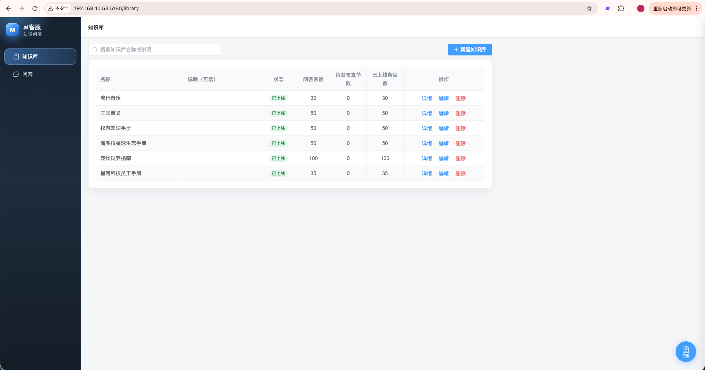

# AmendAQ 在 mycs 里是一本可以改的问答

> 系列：AmendAQ, a better RAG?（2/3）
>
> 上一篇：[如果一条制度可以改完就生效，还要先向量化吗](./01-why-amendaq.md)

AmendAQ 是这套做法的名字。[mycs](https://github.com/zealot2002/mycs) 是它的实现：上一篇的原型收成一条能发布、能提问、能核对的路径。知识单位就是已发布的 AQ。提问时不做向量检索。

一次命中的问题，模型通常只做两件事：看着标题勾编号，再看着勾中的正文写答复。中间取正文、空列表停住、对照原文核对，都是程序。

```text
已选知识库
   ↓
已发布 AQ：编号、标题、摘要（每批最多 200 条，批批都走完）
   ↓
模型只返回编号
   ↓
按编号取出答案全文
   ↓
只根据这些全文写答复
   ↓
规则核对；碰到有上限的数量，由程序算
```

## 没发布的，模型看不见

导入或新建的问答先是草稿。问答只读已发布的条目。一条可以单独改：标题、摘要、正文、发布状态。保存成已发布之后，下一问才会把它算进候选。

批量导入认这种文本：

```text
Q1：工资一般什么时候发到账？
A1：工资按月发放，一般次月 5 个自然日内发放；遇银行假日，提前至前一个工作日发放。
```

问题和答案可以跨行，一直写到下一题。导进去仍是草稿，要点发布才进入提问。写成「问题：」「答案：」而没有 `Q` / `A` 编号时，解析结果是 0 行，库是空的，问什么都拒答。

界面上，已发布的条数写在知识库列表里。点进一条，改的是这一条的正文，不是一次重新嵌入。




这就是 AQ 的维护方式。结转上限、礼品金额、上报时限，各自占一条。改完发布，地址还是原来的编号，正文已经是新的。

## 模型只交编号

知识库已经由人选定，就不再单独做一次「这是办件还是政策」的意图分类。那一次请求不增加知识。

勾选时，模型看到的是每条的三样东西：

```text
section_ref   编号，例如 1.9
title         问题
summary       答案开头
```

200 条以内一次送完。超过 200 条就分批，每一批都送，程序把编号并起来。模型不能返回「后面不用看了」。211 条的那次对照就是两批都走完。

模型只许返回：

```json
{"section_refs":["1.9"],"reason":""}
```

编号必须来自这次给它的列表。程序丢掉不在列表里的编号。一条都对不上，就返回空数组。

空数组是拒答。年终奖如果有一条写明「手册没有这条规定」，勾中它，照它说没有。如果整本库都对不上，也停，不换一条近题凑上去。

勾中的编号才去取答案全文。所以模型在选择时还没看见全文，在作答时只看见被选中的全文。没被勾中的事，不能靠常识补上。


同一套页面可以换库。过程不变：理解这一步跳过，然后勾选。


## 词面分不负责「找得到」

本地有一个按用词重合打分的函数。制度手册里，问法经常和标题不一样：「笔记本丢了」对上的摘要是「设备丢失」。用词重合不够，这条会掉出候选。所以它不做主检索。

它只在一种情况下出场。模型一次勾得太多，普通题超过 5 条、枚举题超过 24 条，才用这个分数把多出来的编号裁掉。找得到找不到，仍由模型看摘要决定。

讨论过用向量相似度做短名单：先留大约 8 条，再让模型在短名单里挑。短名单没有接进主路径。标题像的错条，相似度会留下；摘要里已经写明的另一件事，相似度也会丢掉。当前选择是把整份标题交给模型，用一次读入换「换一种说法仍能对上」。

这个选择有价钱。第三篇的 211 条库上，AmendAQ 每题都要把标题扫完，输入 token 明显高于只取前 5 段的传统 RAG，单题也更慢。

## 答复能不能发出去，程序说了算

写答复的要求钉在取回来的正文上。

- 这件事正文已经写了，就按正文写完。发薪如果写了银行假日提前发放，就不要再补一句「未检索到银行放假怎么办」。
- 题目里已经给出的事实，拿去对照正文的条件。客户已经要求「优先考虑」，礼品条款又禁止利益冲突，结论就是不能收。不能把已经发生的条件改写成还没发生。
- 不要先写一条正文里没有的做法，再用「未检索到」把这条做法收回。离职折现如果正文没写，就说没写，不要先写「应当结清」。

核对不再问模型「你觉得对不对」。程序看答复和取回来的正文：结论是不是又被「未检索到」收回，义务是不是没有依据，禁止是不是被说成许可。空召回仍然不算有依据。

有上限的数量也不让模型心算。年假题是已经结转 8 天，再满一个工作年。正文是满一年 15 天，结转上限 30 天。8+15=23，没有顶到 30。程序在「已有、新增、上限」都恰好一个、单位都是天的时候，算 `min(已有+新增, 上限)`，再写进结论。对不上这三种数，就不算，仍交给模型，避免用错公式硬填。

## 这条路径覆盖到哪

mycs 现在跑的就是上面这一截：人选库、只勾已发布 AQ、按编号取正文、规则核对、有上限的数量由程序算。

它适合一次一本知识库、几十到两百来条已发布问答。政府办事指南、企业制度、学校政策，材料本来就是「一问一答、会改版」的，和这个形状相符。动态事实（办件进度、工单、学籍）可以另接状态接口；许多咨询只靠这本 AQ 就能答完。

它不回答百万文档里「哪一份合同提到了这个词」。那种搜索的单位是文档，不是一条可发布的制度。

代码对应关系：

| 做什么 | 哪里 |
|--------|------|
| 选定知识库就跳过意图分类 | `src/mycs/agent/loop.py` |
| 整表勾选，分批也走完 | `src/mycs/planning/flat_faq.py` |
| 勾选与作答提示 | `config/prompts.txt` |
| 超出条数才用的词面分 | `src/mycs/knowledge/search.py` |
| 已有数量加上限 | `src/mycs/skills/capped_quantity.py` |
| 规则核对 | `src/mycs/verifier.py` |
| 发布后才进入问答 | `frontend/src/views/KnowledgeDetailView.vue` |

下一篇把这条路径和一条钉死的传统 RAG、以及 LightRAG 放在同一本《澄海精密员工手册》上：[同题对照之后，有些场景可以选择 AmendAQ](./03-when-to-choose-amendaq.md)。
