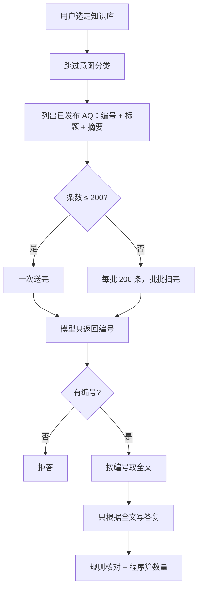
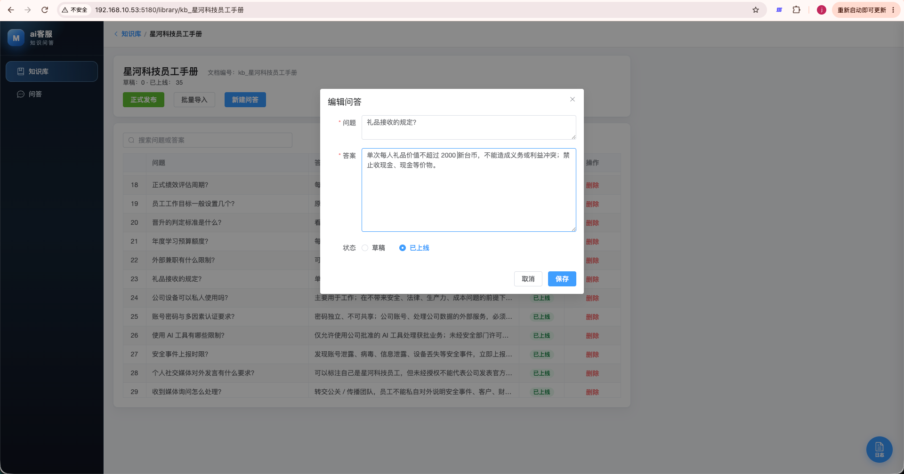
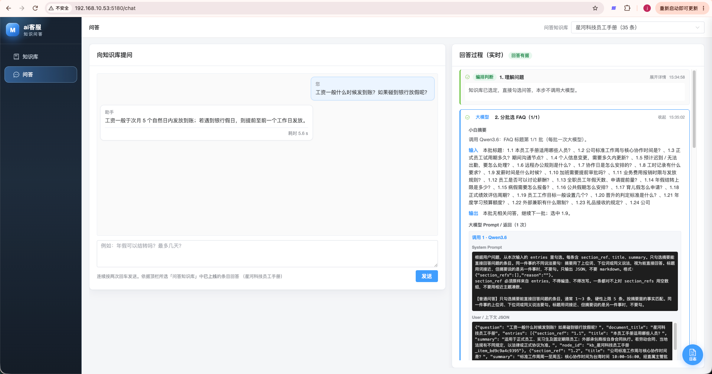
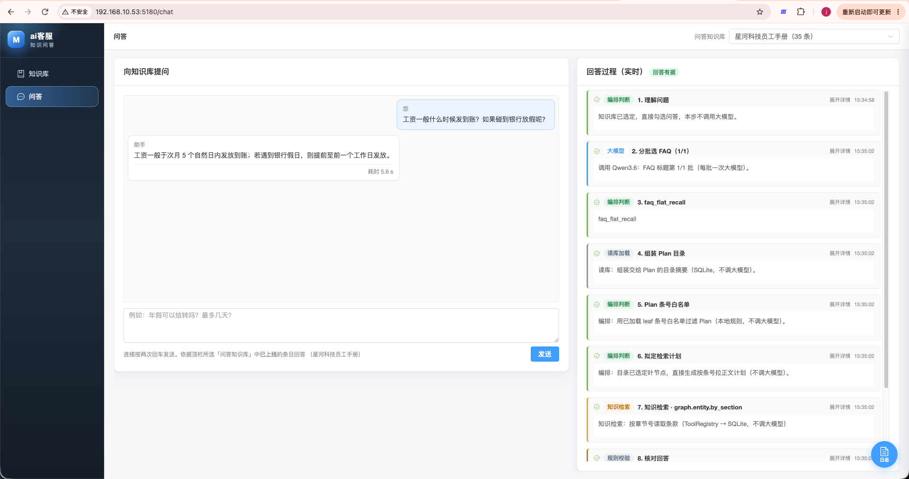

# 我们做了 AmendAQ：可改的问答，发布就是索引

> 系列 [AmendAQ, a better RAG?](../SERIES.md)（2/3）  
> 上一篇：[RAG 这六年怎么走过来的、2026 年前沿在做什么、以及它还剩哪些没解决的问题](./01-why-amendaq.md)  
> 本篇：一次提问的实际路径——入库、勾编号、核对，以及试过又拿掉的两条路。  
> 下一篇：[澄海手册对照：AmendAQ、传统 RAG 与 LightRAG](./03-when-to-choose-amendaq.md)

---

上一篇停在两句话上：要在一堆不确定的文本里找到相关的那一段，就先向量化；维护对象本来就是一条能指认、能改掉、能撤回的问答，就不必。理由也写了——有损发生在「压成向量」这一步。

这一篇写「不压」之后，一次提问实际怎么走。

先把名字说清楚。**AQ** 是一条可以修订、可以发布、可以撤回的问答，编号就是它的地址。**Amend** 指修订只动这一条、随发布生效：你改的就是这一条，发布之后，勾选读到的已经是新标题和新摘要。合起来，AmendAQ 是「改完再按编号作答」，代码在 [AmendAQ](https://github.com/zealot2002/AmendAQ)。



这张图里只有两处需要模型：勾编号，写答复。取正文、判断有没有、核对，全是程序。

把它和一条常见管线摊开对比，差别大概是这几行：

| | 传统 RAG（本对照里的管线） | AmendAQ（AmendAQ 主路径） |
|---|---|---|
| 知识形态 | 源文档切块 / 向量段 | 已发布 AQ，一条一问一答 |
| 提问时检索 | BM25 + 向量 + 重排，取前 5 段 | 不按向量找段；读标题列表勾 `section_ref` |
| 证据 | 检索回来的片段 | 勾中条目的**完整正文** |
| 改一条制度 | 重切、重嵌、查旧块是否还在 Top-K | 改 AQ → 发布 |
| 校验 | 常无或再问模型 | 程序规则核对，不让模型自证 |

---

## 一、一条 AQ 怎么入库

导入或新建的问答，进库时都是**草稿**，人工审核无误后，发布。

```text
Q1：工资一般什么时候发到账？
A1：工资按月发放，一般次月 5 个自然日内发放；遇银行假日，提前至前一个工作日发放。
```


运营人员可以随时维护已发布 AQ，改标题、摘要、正文或状态，发布。地址还是原来的编号，正文已经是新的。



---

## 二、模型只交编号

知识库已经由人选定了，就不再单独问一次「这是办件还是政策」——那一次请求不增加任何知识。

模型看到的是每条的三样东西：`section_ref`、`title`、`summary`。全文留到勾中之后才给。它只许返回列表里的编号；一条都对不上，就交一个空数组。空数组就是拒答，不拿近义的一条凑数。



这条路有两个坑，都踩过。

**「后面不用看了」。** 曾经允许模型说这句话，结果第一批就把该看的漏掉，后面的批次也没补回来。现在每批都扫完、批批都送：200 条以内一次送完，超过就分批，程序把编号并起来。

**没被勾中的，不能靠常识补。** 勾中才取全文，答复只对着这些全文写。模型在这条路径上没有「顺手想起点什么」的机会——这是设计，不是限制。

---

## 三、我试过、又拿掉的两条路

**向量短名单。** 先按相似度留 8 条，再让模型在里面挑，听起来能省不少读标题的时间。问题是标题像的错条会留下；「笔记本」和「设备丢失」这种上下位，可能在短名单那一步就已经被丢掉，模型再准也挑不出来。没进主路径。

**词面分当主检索。** 制度里换说法太常见，「笔记本丢了」对不上摘要里的「设备丢失」，词面重合不够。它现在只剩一个用处：模型一次勾得太多（普通题超过 5 条、枚举题超过 24 条）时，拿它把多的裁掉。找不找得到，仍由模型看摘要决定。

---

## 四、答复能不能发出去，程序说了算

写答复的要求，钉在取回来的正文上。

正文写了的，就按正文写完，不要再补一句「未检索到」把自己的话收回去。题目里已经发生的事实（客户已经要求优先考虑），要拿去对照条款的条件，该禁止就禁止、该允许就允许，不能改写成还没发生。正文没写的，就说没写，不要先编一条再收回。

核对不是再问模型「你觉得对不对」。程序看答复和正文：结论有没有被自己收回、义务有没有依据、禁止有没有被说成许可。

有上限的数字也不让模型心算。以年假为例：已结转 8 天，再满一年加 15 天，上限 30 天。程序在「已有、新增、上限」都恰好一个、单位都是天的时候，算 `min(已有 + 新增, 上限)` 再写进结论；对不上这三种数就不算，仍交回模型，免得用错公式硬填。



---

## 五、到这里，AmendAQ 就做完了

选库、只勾已发布、按编号取正文、规则核对、有上限的数量由程序算——这一截现在跑得通了，代码在 [AmendAQ](https://github.com/zealot2002/AmendAQ)。

做得怎么样，说了不算，跑一遍才知道。下一篇用同一套虚构《澄海精密员工手册》跑分——[源手册与 211 条已发布问答](../对比测试_澄海手册_知识库.md)、[60 题与标准答案](../对比测试_澄海手册_题目.md) 都在仓库里公开，可对照下文表格逐题核对。

下一篇：[澄海手册对照：AmendAQ、传统 RAG 与 LightRAG](./03-when-to-choose-amendaq.md)。
